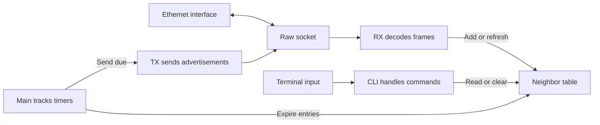

# CDP Discovery in C

A C implementation of Cisco Discovery Protocol for Linux. It reads CDP advertisements from a raw Ethernet socket, keeps a table of active neighbors, and sends its own announcements on the selected interface.

## Project notes

- [Presentation](docs/CDP-Implementation-in-C.pdf) — packet layout, thread design, and anonymized lab results.
- [Packet notes](docs/PACKET-NOTES.md) — untagged frame offsets, checksum flowchart, and the Addresses TLV compatibility fix.
- [Architecture](docs/ARCHITECTURE.md) — module map, shared state, and shutdown.
- [Validation](docs/VALIDATION.md) — offline checks and the scope of the live lab evidence.

## Runtime

The program targets Linux and builds as C11 with POSIX threads. Its executable, `cdp_rx_tx`, takes one Ethernet interface name. The raw socket requires root or `CAP_NET_RAW`. Transmission is enabled at startup.

## CLI

| Command | Action |
|---|---|
| `help` or `?` | List commands |
| `show cdp` | Show local status, timers, and current configuration |
| `show cdp neighbors` | List neighbors and remaining holdtime |
| `show cdp neighbors detail` | Show the stored fields for each neighbor |
| `show cdp traffic` | Show receive and transmit counters |
| `clear cdp table` / `clear cdp counters` | Clear neighbor entries or reset counters |
| `cdp enable` / `cdp disable` | Enable or pause discovery |
| `cdp timer <5..254>` | Set the send interval in seconds |
| `cdp holdtime <10..255>` | Set the advertised holdtime in seconds |
| `mode 1` / `mode 2` | Switch between commands and live events |
| `quit` or `exit` | Shut down cleanly |

Holdtime must exceed the send interval. Defaults are **60 seconds** between sends and **180 seconds** advertised holdtime. `Ctrl+C` and `SIGTERM` also request shutdown.

## Design and scope

- **RX** decodes CDPv1 and CDPv2. It checks frame length, checksum, and TLV bounds. Device ID and Port ID are required. Unknown TLVs are skipped when their lengths fit. The Addresses TLV accepts zero-filled trailing bytes within its declared length after parsing the address entries.
- **TX** sends untagged CDPv2 and advertises up to one IPv4 and one IPv6 address from the selected interface. The Native VLAN and Voice VLAN Reply advertisements are disabled by default. Local identity and optional fields are set in [runtime.h](code/runtime.h).
- **Main** advances timers using elapsed time from a monotonic clock. RX, TX, and CLI run as separate workers. Main joins them before closing the shared socket.
- The neighbor table holds **32 entries** on one selected interface. Entries are matched by source MAC, Device ID, and Port ID. A matching advertisement refreshes the entry, which expires when its holdtime runs out. A full table refuses new entries until a slot opens.
- Graceful shutdown attempts a TTL-zero withdrawal if TX has previously sent an advertisement.

## Author

**Mahsa Panjehbashi.** I developed this project independently and occasionally used GPT-6 for assistance.

## Learning resources

- [lldpd](https://github.com/lldpd/lldpd) and [ladvd](https://github.com/sspans/ladvd) helped me learn how existing discovery daemons implement link-layer protocols.
- [NetworkLessons’ CDP packet header guide](https://networklessons.com/network-fundamentals/cisco-discovery-protocol-cdp-packet-header) helped me understand the CDP header and packet layout.
- Jacob Sorber and CodeVault’s YouTube tutorials helped me learn multithreading and the C fundamentals I used in this project.
