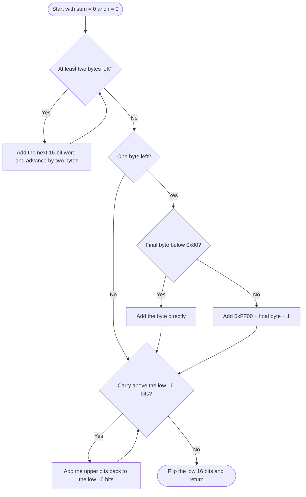

# Packet notes

## Untagged Ethernet layout

Offsets start at zero. Multi-byte fields use network byte order.

| Byte offset | Field | Contents |
|---|---|---|
| 0–5 | Destination MAC | CDP multicast address `01:00:0c:cc:cc:cc` |
| 6–11 | Source MAC | Sender’s interface MAC |
| 12–13 | IEEE 802.3 length | LLC/SNAP and CDP message length, excluding Ethernet padding |
| 14–21 | LLC/SNAP | `aa aa 03 00 00 0c 20 00` |
| 22 | CDP version | TX sends version 2 |
| 23 | Holdtime | Seconds the receiver should retain the entry |
| 24–25 | Checksum | 16-bit checksum of the CDP message |
| 26 onward | TLVs | Two-byte type, two-byte total length, then the value |

## Checksum

The checksum covers the CDP header and TLVs. TX calculates it with the checksum field set to zero. RX checks the received CDP message with the checksum field in place. A valid message produces zero from the checksum routine.

## A valid neighbor the parser used to drop

In an earlier lab run, a switch advertised an Addresses TLV with a total length of 17 bytes and an address count of zero. The TLV held a four-byte header, a four-byte count, and nine trailing zero bytes. The original parser expected the value to end exactly after the declared entries and rejected the advertisement.

The decoder now accepts zero-filled trailing bytes within the Addresses TLV after it has parsed the declared entries. It still rejects nonzero trailing data and lengths outside the TLV or message. The address count controls how many entries to parse. The total TLV length determines where the next TLV starts.
